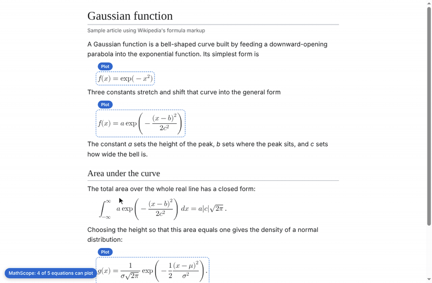

# MathScope 0.2

A Chrome extension that makes equations on Wikipedia interactive. It marks every
formula it can draw. Click one to get a plot with sliders for its symbols:
curves, surfaces, vector fields and 3D shapes.

*Recorded with version 0.1 on a sample article that uses Wikipedia's formula markup.*

[Watch the 30-second demo video with sound](docs/mathscope-demo.mp4) (opens GitHub's video player).

## Install (desktop Chrome, Edge or Brave)

1. Download this repository: **Code > Download ZIP** on GitHub, then unzip it
   (or `git clone https://github.com/vinodhalaharvi/wikipedia-mathscope.git`).
2. Open `chrome://extensions`.
3. Turn on **Developer mode** (top right).
4. Click **Load unpacked** and choose the folder that contains `manifest.json`.
5. Open a Wikipedia article with formulas, for example
   `https://en.wikipedia.org/wiki/Gaussian_function`, and reload it.

A badge at the bottom left reports how many equations can plot. Each of those gets a
blue "Plot" pill and a
dashed blue outline. Click the pill or the equation to open the panel.
Press Esc or **Close** to dismiss it.

## What it draws

| Pill | Formula shape | What you get |
| --- | --- | --- |
| Plot | `f(x) = …` or `name = …` | A curve with its derivative. Complex results show real and imaginary parts. |
| Surface | `f(x, y) = …`, `z = …` | A colour map with contour lines, or a 3D surface you can rotate. |
| Curve | `x² + y² = r²` and similar | The curve where both sides are equal. |
| Field | `F = y î − x ĵ`, `F(x, y) = (−y, x)` | Arrows, coloured by curl, divergence or strength. |
| 3D field | fields with three components | Arrows in a box you can rotate. Can show the curl instead. |
| Shape, 3D shape | `x = …, y = …, (z = …)` given together | The curve or surface they trace, such as a sphere from spherical coordinates. |

Every symbol that is not on an axis becomes a slider.

It also understands:

- Several definitions in one formula (rows of an aligned block, or separated by commas).
- Piecewise definitions written with cases.
- erf, the gamma function, factorials, floor, absolute value, min and max.
- Sums and definite integrals, evaluated numerically. Infinite sums get a "terms" slider.
- Functions defined elsewhere on the same page: `Q(x) = 1 − Φ(x)` works when the
  article also defines Φ.

It skips: limits, derivatives and differential equations, matrices, sums over
indexed data such as `Σ xᵢ`, and inline formulas that Wikipedia writes as plain
text instead of TeX.

## How it works

| File | Role |
| --- | --- |
| `content.js`, `content.css` | Runs on the page. Reads each formula's TeX source, marks the drawable ones, hosts the panel iframe. |
| `math.js` | Splits and classifies formulas, and evaluates them by walking the parsed tree. No generated code, as Manifest V3 requires. |
| `plots.js` | Draws curves, maps and the 3D views on a plain canvas. |
| `panel.html`, `panel.js`, `panel.css` | The panel: controls, sliders and readouts. |
| `vendor/compute-engine` | Cortex Compute Engine 0.173.0 (MIT). TeX parsing and symbolic derivatives. |
| `vendor/katex` | KaTeX 0.19.1 (MIT). Typesets formulas in the panel. |

The extension requests no permissions, makes no network requests, and only
runs on `*.wikipedia.org`. Nothing on Wikipedia itself is changed.

## Known limits

- The adapter was checked against live Wikipedia articles in November 2026. If
  Wikipedia changes its formula markup again and nothing is marked, look at
  `texOf` in `content.js`.
- The same letter can mean different things in different sections of an article.
  A cross-reference always uses the first definition on the page, which is
  sometimes the wrong one.
- Integrals to infinity are cut off at ±10, and infinite sums are truncated, so
  both are approximations. A truncated series goes wrong far from its centre.
- Slider ranges are fixed at −5 to 5 and starting values are guesses.
- `γ` and `φ` are treated as variables, `e`, `i` and `π` as constants.
- Symbolic derivatives are correct but not tidied into their shortest form.
- The 3D views are drawn back to front without true hidden-surface removal, so
  self-intersecting shapes can show small ordering glitches.

## License

MIT, see `LICENSE`. The bundled libraries in `vendor/` keep their own MIT
licenses, included beside each one.
